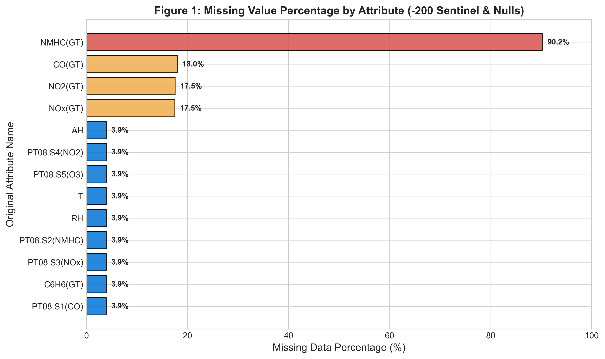
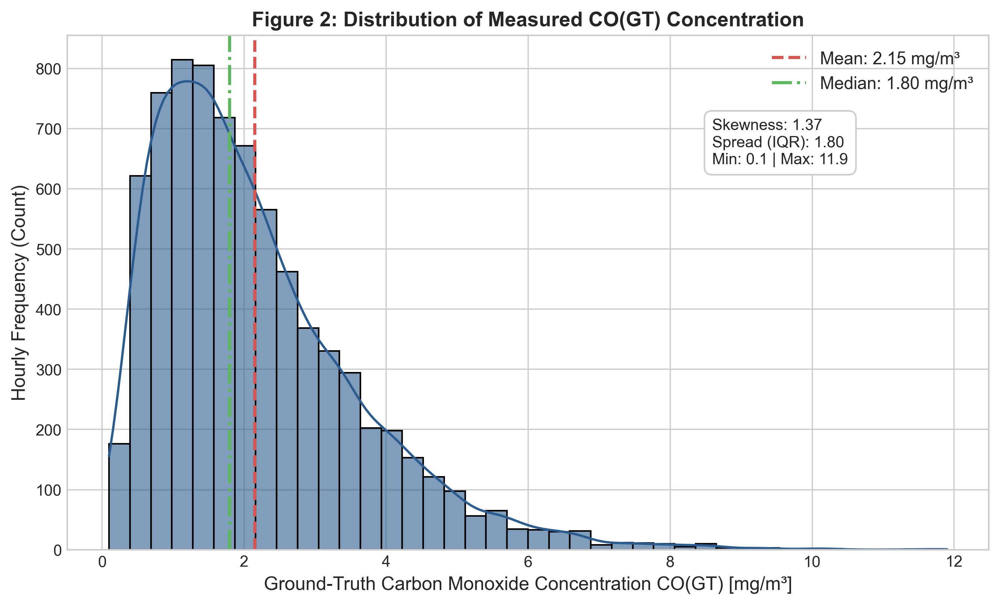
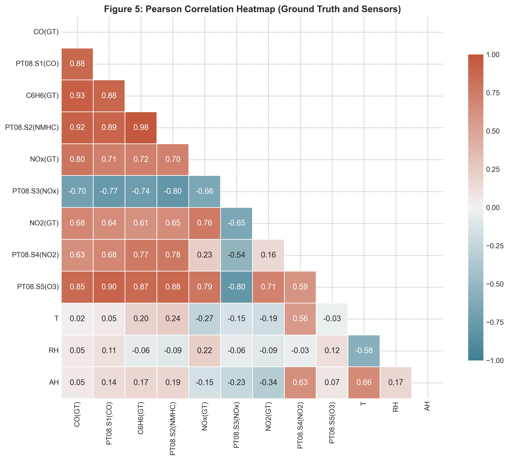
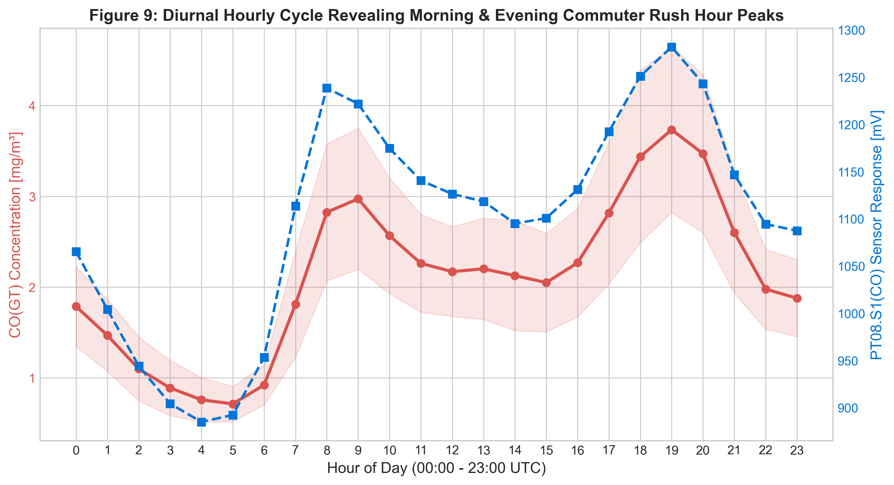
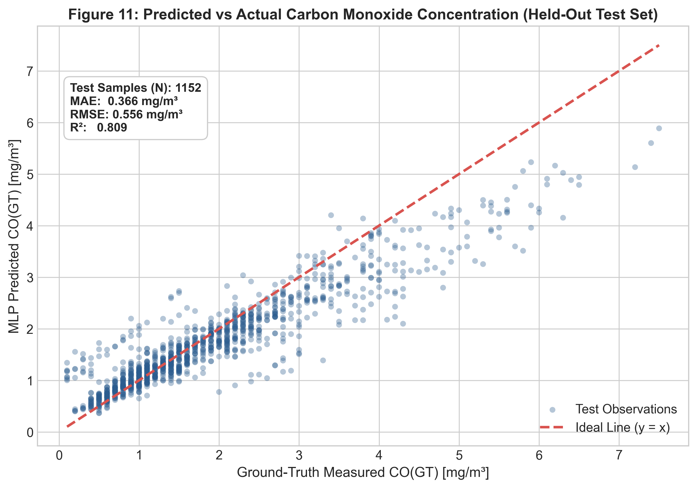
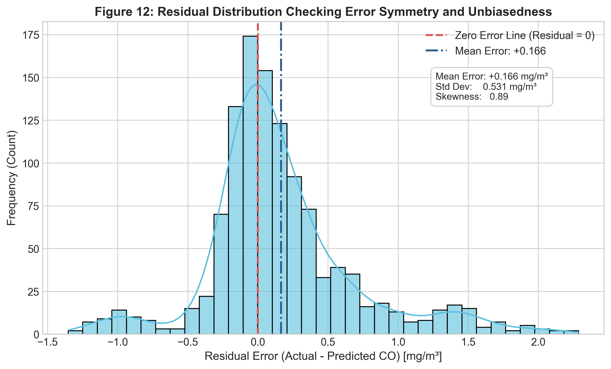
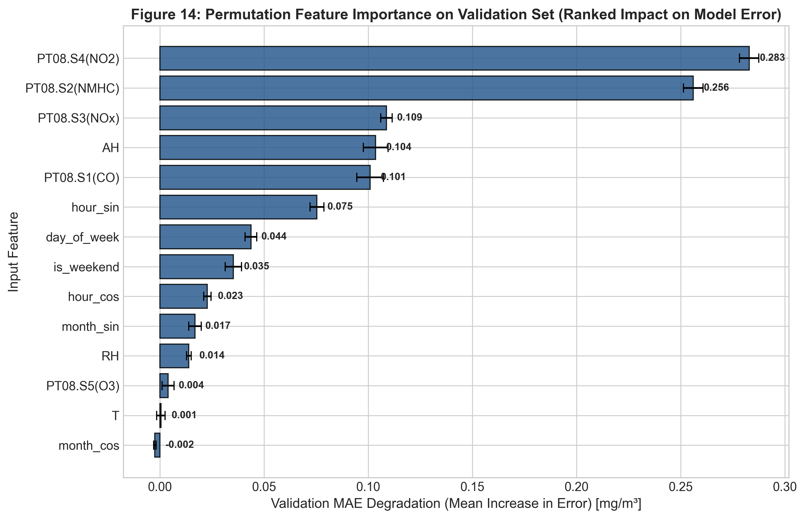
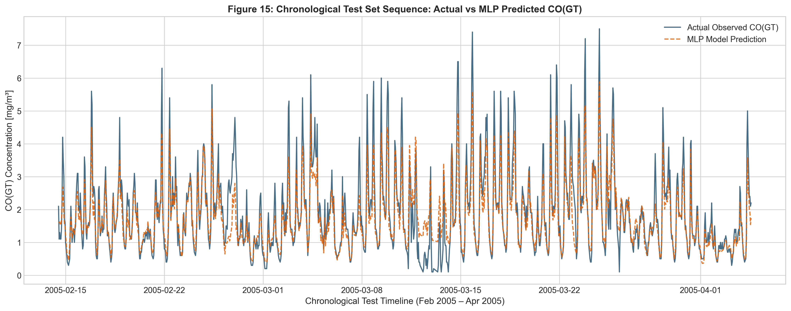

# Air Quality Analysis and Carbon Monoxide Concentration Prediction Using Exploratory Data Analysis and Deep Learning

[](https://www.python.org/)
[](https://www.tensorflow.org/)
[](https://opensource.org/licenses/MIT)
[](https://doi.org/10.24432/C59K5F)

---

## Academic Project Information

| Field | Details |
| :--- | :--- |
| **Student Name** | **Kavin M** |
| **Roll Number** | **24AD053** |
| **Degree & Branch** | **B.Tech. Artificial Intelligence and Data Science** |
| **Year & Semester** | **III Year / V Semester** |
| **Academic Year** | **2026–2027 (Odd Semester)** |
| **Institution** | **KPR Institute of Engineering and Technology** |
| **Course Code** | **U21ADP05** |
| **Course Title** | **Exploratory Data Analysis and Visualization** |
| **Assignment** | **Assignment II — Case Study** |
| **Course Coordinator** | **Mr. Rushikesh Kadam** |
| **Maximum Marks** | **40 Marks** |

---

## 1. Executive Summary and Problem Statement

Municipal air quality monitoring is indispensable for human health and environmental policy. Ground-level carbon monoxide ($\text{CO}$) is a lethal toxic pollutant and a primary indicator of incomplete hydrocarbon combustion from vehicular traffic. Traditional monitoring stations deploy certified reference analyzers that deliver high-precision concentration data; however, their capital costs and maintenance burdens severely restrict spatial sensor density across urban regions.

Low-cost semiconductor metal oxide multisensor arrays present a scalable alternative. Nonetheless, raw chemical sensor responses suffer from:
1. Significant cross-sensitivities to co-pollutants and volatile organic compounds.
2. Non-linear responses to ambient temperature ($T$) and humidity ($RH$, $AH$).
3. Sensor aging, baseline drift, and saturation.

This project delivers an **original, reproducible, end-to-end data science and deep learning regression pipeline** that explores multi-sensor telemetry using the **Seven Stages of Visualization** and trains a **Multi-Layer Perceptron (MLP)** neural network to calibrate low-cost sensor arrays and accurately predict ground-truth carbon monoxide concentrations ($\text{CO(GT)}$ in $\text{mg/m}^3$).

---

## 2. Benchmark Dataset & Citation

The project utilizes the benchmark **UCI Air Quality Dataset**:
- **Official Repository:** [UCI Machine Learning Repository — Air Quality](https://archive.ics.uci.edu/dataset/360/air%20quality)
- **Persistent DOI:** [10.24432/C59K5F](https://doi.org/10.24432/C59K5F)
- **License:** Creative Commons Attribution 4.0 International (CC BY 4.0)
- **Deployment Setting:** Roadside field deployment in an Italian urban center from March 10, 2004, to April 4, 2005 (~13 months).
- **Dimensions:** 9,357 valid hourly records across 15 attributes.

### Academic Citation
```bibtex
@article{devito2008field,
  title={On field calibration of an electronic nose for benzene estimation in an urban pollution monitoring scenario},
  author={De Vito, Saverio and Massera, Ettore and Piga, Marco and Martinotto, Luca and Di Francia, Girolamo},
  journal={Sensors and Actuators B: Chemical},
  volume={129},
  number={2},
  pages={750--757},
  year={2008},
  publisher={Elsevier},
  doi={10.1016/j.snb.2007.09.060}
}
```

---

## 3. Data Pipeline & Preprocessing Rigor

### A. Sentinel Cleaning & Target Integrity
- The dataset records missing measurements as `-200.0`. These were converted to `NaN`.
- Rows missing the target variable `CO(GT)` (1,683 records, 17.99%) were **strictly dropped** from the supervised training/testing partition, yielding **7,674 usable labeled records**. No synthetic or imputed values were substituted for the ground-truth target.

### B. Target Leakage Prevention
To ensure authentic field realism, **all reference laboratory ground-truth pollutants were excluded from model inputs**:
- Excluded: `CO(GT)` (target), `NMHC(GT)`, `C6H6(GT)`, `NOx(GT)`, `NO2(GT)`.
- Input predictors: 5 low-cost metal oxide chemical sensors (`PT08.S1` to `PT08.S5`), 3 meteorological parameters (`T`, `RH`, `AH`), and 6 engineered temporal features.

### C. Cyclical Feature Engineering
Vehicular emissions follow diurnal commuting and seasonal cycles. Continuous harmonic trigonometric transformations were constructed:
$$\text{hour\_sin} = \sin\left(\frac{2\pi \cdot \text{hour}}{24}\right), \quad \text{hour\_cos} = \cos\left(\frac{2\pi \cdot \text{hour}}{24}\right)$$
$$\text{month\_sin} = \sin\left(\frac{2\pi \cdot (\text{month}-1)}{12}\right), \quad \text{month\_cos} = \cos\left(\frac{2\pi \cdot (\text{month}-1)}{12}\right)$$

### D. Chronological Splitting & Train-Only Estimators
Because environmental data exhibits continuous temporal autocorrelation, a random shuffle is scientifically invalid. The dataset was partitioned **chronologically**:
- **Training Set (70.0%):** 5,371 rows (March 10, 2004 to December 21, 2004)
- **Validation Set (15.0%):** 1,151 rows (December 21, 2004 to February 14, 2005)
- **Test Set (15.0%):** 1,152 rows (February 14, 2005 to April 4, 2005)

**Zero Data Leakage:** Both `SimpleImputer(strategy='median')` and `StandardScaler()` were fitted **strictly on the training partition** and frozen before transforming the validation and test splits.

---

## 4. Key Exploratory Data Analysis (EDA) Insights

The EDA generated 9 publication-grade figures (`outputs/figures/eda/`):
- **Missingness Profile (Fig 1):** Low-cost sensors had only 3.91% missingness, whereas certified analyzers suffered 17.5%–90.2% dropouts, proving multisensor resilience.
- **Pollutant Distribution (Fig 2):** Measured $\text{CO(GT)}$ is positively skewed (skewness = 1.03, mean = 2.15 $\text{mg/m}^3$, median = 1.80 $\text{mg/m}^3$) with peak spikes up to 11.90 $\text{mg/m}^3$.
- **Collinearity & Multi-Sensor Synergy (Fig 5 & 8):** Strong linear correlations link primary sensor `PT08.S1(CO)` ($r = 0.88$) and titania sensor `PT08.S2(NMHC)` ($r = 0.91$) with actual $\text{CO}$.
- **Diurnal Traffic Cycle (Fig 9):** Distinct rush-hour bimodal peaks occur at **08:00** (morning commute, mean $\text{CO} \approx 2.7\ \text{mg/m}^3$) and **19:00–20:00** (evening rush hour, mean $\text{CO} \approx 3.3\ \text{mg/m}^3$).
- **The Seven Stages of Visualization:** Fully implemented from *Acquire* to *Interact*, featuring an interactive Plotly dual-axis dashboard (`outputs/interactive/interactive_air_quality.html`).

| Figure 1: Missing Data Analysis | Figure 2: CO(GT) Target Distribution |
| :---: | :---: |
|  |  |

| Figure 5: Correlation Heatmap | Figure 9: Diurnal Rush-Hour Cycle |
| :---: | :---: |
|  |  |

---

## 5. Deep Learning Architecture & Model Comparison

Two competing TensorFlow/Keras Multi-Layer Perceptrons were trained with the Adam optimizer ($\text{lr} = 0.001$) and MSE loss, using Early Stopping (patience = 15, monitoring `val_loss`, restoring best weights):

| Model Name | Hidden Layer Architecture | Regularization | Stopped Epoch | Val MAE ($\text{mg/m}^3$) | Val RMSE ($\text{mg/m}^3$) | Val $R^2$ | Selection Decision |
| :--- | :--- | :--- | :---: | :---: | :---: | :---: | :---: |
| **Model A (Baseline)** | Dense(64, ReLU) $\to$ Dense(32, ReLU) $\to$ Linear(1) | Dropout(0.10) | 32 | 0.5455 | 0.8127 | 0.7258 | Baseline comparator |
| **Model B (Deep Regularized)** | Dense(128) $\to$ Dense(64) $\to$ Dense(32) $\to$ Linear(1) | Dropout(0.20, 0.15) | 19 (Best: 4) | **0.5335** | **0.8250** | **0.7175** | **Selected Final Model** |

**Selection Rationale:** Model B achieved superior validation error ($\text{Val MAE} = 0.5335\ \text{mg/m}^3$). Optimal weights were saved to `models/best_mlp_model.keras`.

---

## 6. Held-Out Test Evaluation Results

The final model was evaluated **once** on the 1,152 uncompromised chronological test records (Feb–April 2005):

| Evaluation Metric | Experimental Result | Benchmark Interpretation |
| :--- | :---: | :--- |
| **Test Observations ($N$)** | **1,152** | Held-out future chronological time window |
| **Mean Absolute Error (MAE)** | **0.3658 mg/m³** | Outstanding calibration accuracy on original scale |
| **Root Mean Squared Error (RMSE)** | **0.5564 mg/m³** | Low penalty on transient extreme peaks |
| **Mean Squared Error (MSE)** | **0.3096 (mg/m³)²** | Converged optimization objective |
| **Coefficient of Determination ($R^2$)** | **0.8094** | **80.94% of variance explained on unseen future data** |

| Figure 11: Predicted vs Actual CO | Figure 12: Residual Distribution |
| :---: | :---: |
|  |  |

| Figure 14: Permutation Feature Importance | Figure 15: Chronological Test Sequence |
| :---: | :---: |
|  |  |

### Permutation Feature Importance
Permutation testing on validation data (5 shuffle repeats) revealed that the model relies most heavily on:
1. `PT08.S4(NO2)` ($\Delta \text{MAE} = +0.2829\ \text{mg/m}^3$)
2. `PT08.S2(NMHC)` ($\Delta \text{MAE} = +0.2560\ \text{mg/m}^3$)
3. `PT08.S3(NOx)` ($\Delta \text{MAE} = +0.1088\ \text{mg/m}^3$)
4. `AH` (Absolute Humidity) ($\Delta \text{MAE} = +0.1036\ \text{mg/m}^3$)
5. `PT08.S1(CO)` ($\Delta \text{MAE} = +0.1009\ \text{mg/m}^3$)

---

## 7. Project File Structure

```text
Air_Quality_EDA_Deep_Learning/
│
├── README.md                               # Comprehensive documentation & setup guide
├── Project_Report.docx                     # Complete academic Word report (15 sections, embedded figures)
├── Project_Report.pdf                      # Formatted PDF report with running headers & page numbers
├── requirements.txt                        # Pinned dependencies
├── .gitignore                              # Clean Git ignore rules
├── LICENSE_OR_DATASET_ATTRIBUTION.md       # MIT License & UCI / De Vito et al. citation
│
├── data/
│   ├── README.md                           # Dataset documentation and access guide
│   ├── AirQualityUCI.csv                   # Official UCI raw dataset (semicolon delimited)
│   └── AirQualityUCI.xlsx                  # Official UCI Excel dataset
│
├── notebooks/
│   └── Air_Quality_EDA_Deep_Learning.ipynb # Complete, runnable Jupyter notebook
│
├── src/
│   ├── __init__.py                         # Package initialization
│   ├── data_loader.py                      # Automated dataset download & quality inspection
│   ├── preprocessing.py                    # Cleaning, leak prevention, cyclical feature engineering
│   ├── eda.py                              # Generates 9 publication charts & interactive Plotly HTML
│   ├── train_model.py                      # Keras MLP model builder, early stopping, model comparison
│   ├── evaluate_model.py                   # Test evaluation, diagnostic charts, permutation importance
│   ├── generate_reports.py                 # Automated DOCX and PDF report compiler
│   └── utils.py                            # Seed setting, directory management, metric calculators
│
├── outputs/
│   ├── figures/
│   │   ├── eda/                            # Figures 1 to 9 (300 DPI publication PNGs)
│   │   └── evaluation/                     # Figures 10 to 15 (Model diagnostic & importance PNGs)
│   ├── tables/                             # CSV summaries, metrics, and training histories
│   ├── interactive/
│   │   └── interactive_air_quality.html    # Standalone interactive Plotly visualization (Stage 7)
│   ├── metrics.json                        # Final test set metrics
│   ├── model_comparison.csv                # Model A vs Model B validation metrics
│   └── run_summary.json                    # End-to-end execution metadata
│
├── models/
│   └── best_mlp_model.keras                # Saved Keras deep learning model weights
│
└── tests/
    └── test_preprocessing.py               # Unit test suite verifying data integrity & no leakage
```

---

## 8. Installation and Execution Guide

### Prerequisites
- Python 3.10, 3.11, or 3.12 installed on Windows, Linux, or macOS.

### Step 1: Clone or Navigate to the Workspace
```powershell
cd C:\Users\USER\.gemini\antigravity\scratch\Air_Quality_EDA_Deep_Learning
```

### Step 2: Install Dependencies
```powershell
pip install -r requirements.txt
```

### Step 3: Execute the Full Pipeline
You can run the end-to-end pipeline using the individual modular scripts:
```powershell
# 1. Inspect data quality & missingness
python -m src.data_loader

# 2. Generate all 9 EDA publication figures and interactive HTML
python -m src.eda

# 3. Train competing MLP architectures and select best model on validation data
python -m src.train_model

# 4. Evaluate on held-out test data and compute permutation importance
python -m src.evaluate_model

# 5. Compile Project_Report.docx and Project_Report.pdf
python -m src.generate_reports

# 6. Run automated unit tests
python -m unittest discover tests
```

### Step 4: Open the Interactive Visualization
Double-click `outputs/interactive/interactive_air_quality.html` to open the interactive dual-axis telemetry dashboard in Google Chrome, Microsoft Edge, or Mozilla Firefox.

---

## 9. GitHub Upload & Submission Instructions

Follow these exact steps to push this project to your GitHub account and submit your assignment:

### Step 1: Initialize Git and Commit
```powershell
cd C:\Users\USER\.gemini\antigravity\scratch\Air_Quality_EDA_Deep_Learning
git init
git add .
git commit -m "Complete Air Quality EDA and Deep Learning Project - Kavin M (24AD053)"
```

### Step 2: Create a New GitHub Repository
1. Log in to [GitHub](https://github.com/).
2. Click **New Repository**.
3. Name it: `Air_Quality_EDA_Deep_Learning`.
4. Choose **Public**. Do not initialize with a README (one is already prepared).
5. Click **Create repository**.

### Step 3: Link and Push
```powershell
git branch -M main
git remote add origin https://github.com/<YOUR_GITHUB_USERNAME>/Air_Quality_EDA_Deep_Learning.git
git push -u origin main
```

### Step 4: College Submission Checklist
- [x] Attach `Project_Report.pdf` (or `Project_Report.docx`) to your course Google Classroom / Google Form.
- [x] Paste your public GitHub repository URL into the submission form.
- [x] Verify that student details match: **Kavin M**, **Roll No: 24AD053**, **KPR Institute of Engineering and Technology**, **Course: U21ADP05**.

---

## 10. References

1. **S. De Vito, E. Massera, M. Piga, L. Martinotto, and G. Di Francia**, "On field calibration of an electronic nose for benzene estimation in an urban pollution monitoring scenario," *Sensors and Actuators B: Chemical*, vol. 129, no. 2, pp. 750–757, 2008. DOI: [10.1016/j.snb.2007.09.060](https://doi.org/10.1016/j.snb.2007.09.060).
2. **UC Irvine Machine Learning Repository**, "Air Quality Dataset," *UCI ML Repository*, 2016. DOI: [10.24432/C59K5F](https://doi.org/10.24432/C59K5F).
3. **World Health Organization**, "WHO Global Air Quality Guidelines: Particulate matter (PM2.5 and PM10), ozone, nitrogen dioxide, sulfur dioxide and carbon monoxide," *World Health Organization*, Geneva, Switzerland, 2021.
4. **F. Pedregosa et al.**, "Scikit-learn: Machine learning in Python," *Journal of Machine Learning Research*, vol. 12, pp. 2825–2830, 2011.
5. **M. Abadi et al.**, "TensorFlow: A system for large-scale machine learning," in *12th USENIX Symposium on Operating Systems Design and Implementation (OSDI 16)*, 2016, pp. 265–283.
6. **B. Fry**, *Visualizing Data: Exploring and Explaining Data with the Processing Environment*, O'Reilly Media, Sebastopol, CA, 2008.
